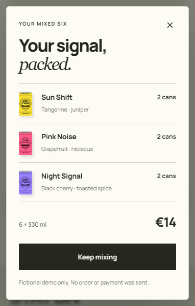
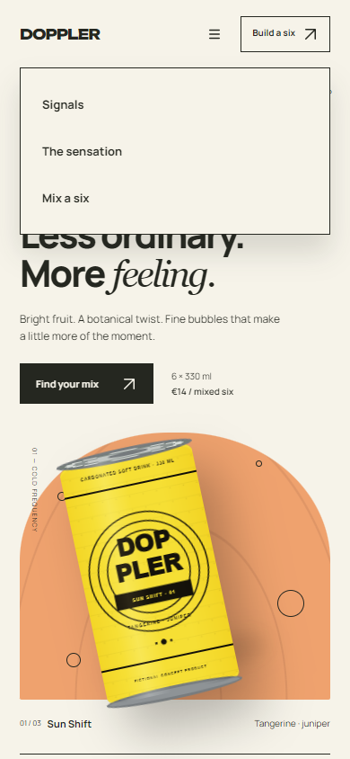
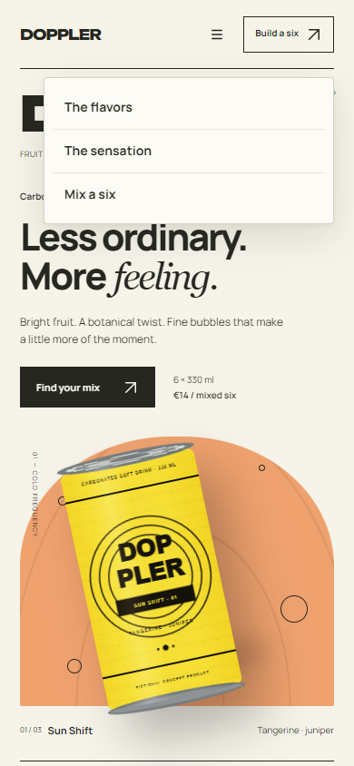

# Design secondary surfaces: menus, modals and selection

Read when a menu/select/combobox/popover is introduced, visually rejected or materially changed. A trigger that looks finished does not certify the surface it opens. Inspect the real open owner, including its portal, theme and scroll container; Direct work can stay with one known owner and its relevant states.

Apply the same positive visual bar to dialogs, drawers, sheets, tooltips and transient panels. Each is an authored composition inside the larger experience: it needs a point of view, clear mass/attention relationships, deliberate type, material and well-finished controls. Do not treat secondary UI as a place to leave framework defaults, loosely padded gray boxes, arbitrary shadows or an unrelated mini design system. Correct interaction and lack of overflow are necessary evidence, not the visual result.

## Compose a modal rather than filling a template

Start with the question the open surface resolves and the content/actions that must be seen together. Set an attention order, then make the actual typography, grouping, width and material carry it. A confirmation can foreground its result and a concise object summary; a dense edit task can lead with the field relationships; a consequential decision may need clear consequences before commitment. Do not apply a giant campaign heading to every utility dialog or flatten an expressive product into browser-default chrome.

Build the header, content and action region as related masses. Title size/weight, line breaks, copy measure, object imagery, row rhythm, dividers and negative space should make one resolved composition. A title should not float far from the object it describes, and a footer should not become a second unrelated card. Preserve useful subordinate facts and make the primary action intentional; conventional quiet dismissal and a named continuation can coexist without two competing primary buttons.

Resolve the surface against the real screen: backdrop opacity/color/blur, panel fill, edge, shadow and corner treatment describe one layering model. Inspect how much of the underlying page remains legible and whether its strongest type/color masses compete. More blur, a thicker border, a large radius or darker gray is not automatic refinement. Carry the site's typographic voice and icon grammar into the open layer while adapting their scale to its task.

Inspect the close control at native size in its actual top-right/header relationship: hit region, glyph weight, optical center, contrast, hover and focus. A tiny raw X on an otherwise polished surface weakens the whole. Keep image/thumbnails truthful, consistently cropped and subordinate to the decision. For long content or enlarged text, give the actual surface a reachable scroll path; do not preserve a ceremonial header/footer at the expense of accessible content/actions.

This confirmation uses a bounded editorial title, three aligned product/quantity rows, a quiet total and one clear continuation. Its warmer paper, restrained edge, backdrop and custom close glyph belong to the surrounding campaign. The result is a complete small composition, rather than a collection of independently styled controls. A frequent expert tool can be equally strong with a denser, plainer title and minimal imagery; preserve the same relationship discipline instead of copying this campaign's typography.

## Choose the interaction before its shell

Distinguish section navigation, a command menu, a single/multiple choice, a searchable combobox, a calendar/color tool and a modal task. They have different grouping, selection and keyboard contracts. A small command list usually needs a compact anchored surface; a long searchable choice can need a bounded list with persistent search; a narrow touch task can justify a sheet. Native platform selection remains a legitimate choice. Do not turn every popup into the same rounded card or add search to three obvious destinations.

Use the established component/API when it preserves semantics and behavior. Do not replace a native select with a superficially prettier div list that loses keyboard selection, naming, value or recovery. If a native OS popup cannot be inspected with available tools, identify that missing proof; a DOM screenshot of the closed trigger is not its open-state evidence.

## Make the trigger and surface one system

Trace trigger → open surface/mount owner → label/option rows → selected/active/focus states → tokens/assets → repeated consumers. Portals often escape the ancestor that supplies font, theme, density or z-index. Verify computed family/weight, background/foreground, separators, radius, shadow, focus and icon slots at the actual portal root, rather than styling only the trigger. A popup's small type should not silently inherit a browser/library default.

Choose width from the content and relationship to the trigger. A value list may align with its field; a short navigation menu should not consume a tablet's full header width merely because `left:0;right:0` is convenient. Preserve long values, localized labels and useful secondary text. Minimum trigger width, readable option extent and maximum viewport width are different constraints. Allow necessary wrapping or a justified truncation strategy; keep the full value accessible.

Choose the coordinate space explicitly. An absolutely positioned local surface uses its local owner; a fixed portalled surface uses projected viewport bounds. Do not apply scroll offsets twice or use a transformed axis-aligned screen box as a local dimension. Check zoom, nested scrolling, sticky headers and transformed ancestors. Flip/shift only when space requires it, keeping a visible relationship to the trigger and avoiding abrupt relocation during keyboard movement.

## Craft the open anatomy

- Use deliberate row proportions: target, text line box, glyph/mark, label gap and internal padding. Align visible icon mass and text baselines; equal SVG boxes do not guarantee alignment. Apply [icon-craft.md](icon-craft.md) to custom glyphs in the real row.
- Separate groups with a small interval or quiet rule when the semantics require grouping. Do not give every option its own card, heading or oversized well. A header/footer earns space only for a real task such as search, group orientation, a commitment or recovery.
- Let selected state, keyboard active/focus, hover, pressed and disabled remain distinguishable. Hover is not selection. A chosen value must survive when keyboard focus moves to another row. A checkmark, weight or shape cue can supplement color when useful; do not add unrelated badges.
- Make the popup a readable layer of the same material system. Resolve its fill against the real substrate, edge contrast, shadow spread and corner joins. A heavy black border plus large shadow can overpower a quiet page; an almost invisible surface can disappear into a dense table. More elevation is not automatically more polish.
- Keep focus paint readable against the surface it actually touches. A filled option's on-color text does not automatically provide a good outer ring. Inspect clipping at panel padding, rounded corners and scroll edges.
- Bound long lists at the actual scroll owner while keeping search/actions reachable. Check the shrinking chain, selected option visibility, wheel/touch/keyboard scrolling and the last row. Do not hide options to make a screenshot tidy.

## Compare a weak shell with a resolved one

This short three-destination list spends substantial space on generic padding and a heavy outer frame. On larger narrow/tablet contexts a full-width shell can separate the small option group from its trigger even more. It fits the viewport, but that alone does not make its density or layering intentional.

The resolved example caps the panel to its content role, positions it from the actual Menu owner, groups consistent rows and uses a quieter edge/elevation. Type remains part of the page system. The open-state and keyboard proof are separate from the closed header. This is an authored navigation example, not a universal width/radius/row-height preset. A long searchable list or touch-oriented modal task can be equally strong with a wider sheet.

## Verify the state, then judge its finish

Use independent postconditions: expanded trigger, correct visible options/value, selected state, active focus and outcome after activation. A click sent to a moving or covered target can leave the popup closed while a screenshot is labelled “open.” The [portable observation contract](visual-system-and-observation.md) records actual postconditions, preserves scroll context, and captures native viewport, whole composition and owner/details.

Inspect closed/open, pointer hover, keyboard active/focus, selected/unselected, disabled and the content-pressure states the component actually has: long labels, groups, empty/no results, loading/error and long lists. Exercise representative repeats such as a toolbar, a form and an overlay only when they consume the shared owner. Include relevant theme, narrow/pressure width, zoom/DPR and viewport edges. Do not run every theoretical state for a bounded known property.

Verify Escape/outside close and focus return, selection/cancel/commit, Tab/arrow behavior and scroll ownership according to the chosen pattern. Do not impose a modal focus trap on a nonmodal menu. Opening motion should clarify origin and settle quickly enough for repeated use; reduced mode keeps immediate usable content. Keep an ambitious campaign's product motion separate from routine option navigation.

For acceptance, inspect the whole open composition and native row/detail. KEEP requires a surface that looks deliberate: balanced extent, coherent type/material, clean row rhythm, clear state distinctions, optical glyph fit and readable layering. Reject a raw generic shell even if every option is clickable. Record the cause, one controlled geometry/type/material change, comparable content/rerender and collateral checks. Preserve supplied designs and justified exceptions; a small popup repair does not reopen the whole product identity.
