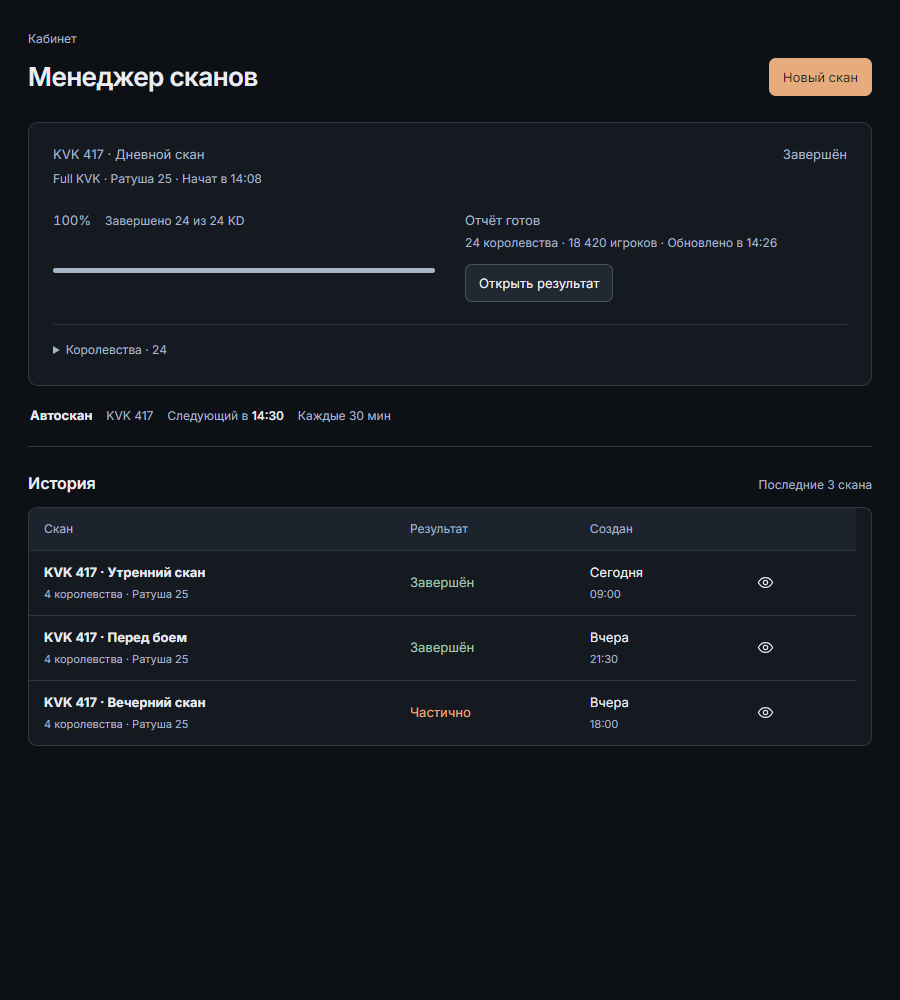
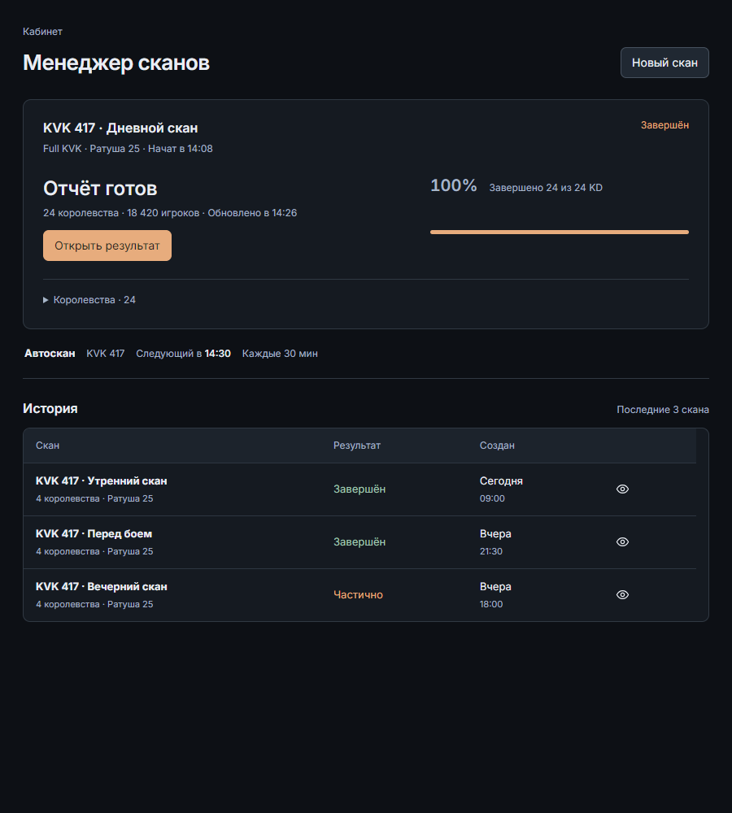
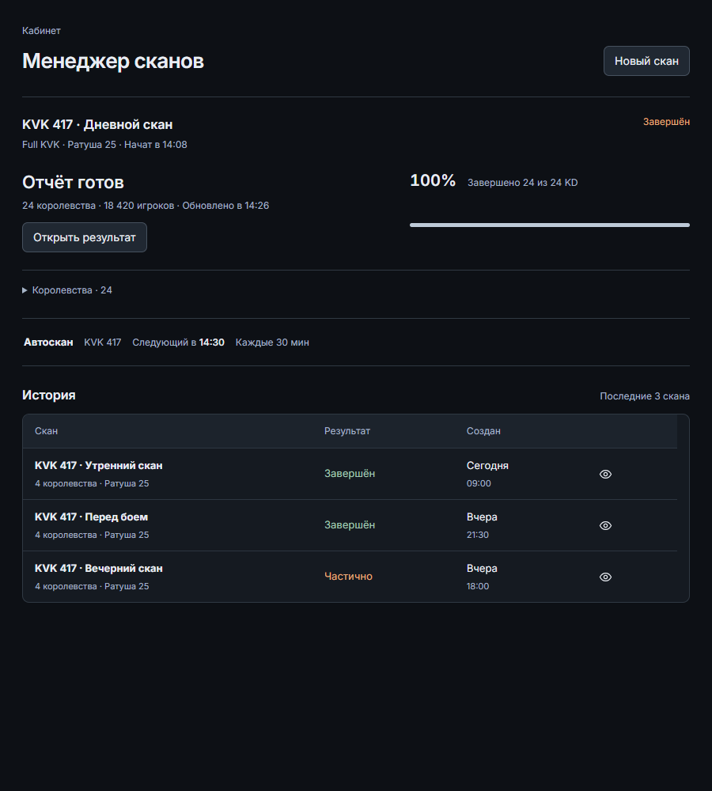
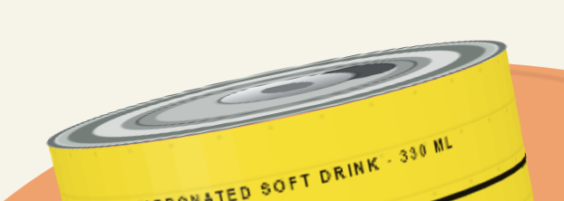

# Reason from visible relationships

Read for an open composition, an unfinished visual direction, or a repair whose perceptual cause is unclear. These authored images teach relationships, not a style to copy. They use the same content and viewport. Their judgments are implementer self-review, not gaze research or proof that an instruction improves future generation.

## Weak and stronger: redirect attention by state

The warm filled **New scan** action in the upper right is the only large chromatic mass. It pulls across the screen before the current result. Within the current run, a long progress bar gives a completed process more area than its usable outcome; the result is small and separated on the right. Uniform small blue metadata further reduces role contrast. No overlap or broken control is needed for this hierarchy to be weak.

The result moves to the start of the reading column and becomes a heading. Its action inherits the warm fill; New scan becomes subordinate. Progress remains visible as corroboration on the right. The heading, count and action form one proximity group; the divider closes that group before optional details. The table retains compact repeated rows, so correcting the current state does not inflate the entire page.

**Mechanism:** redistribute contrast, scale, area and proximity toward the current question. **Prediction:** the completed result should be distinguishable before a new operation without deleting progress or history. **Counterexample:** during a running scan, progress can legitimately lead. A destructive action should not acquire prominence merely because it comes next. Re-render running/error states after this repair; they require different emphasis.

## Two good answers with different strengths

This version groups the current run in a bounded surface and uses color to identify the next action. It suits occasional users, several competing tasks, and situations where a clear transition from monitoring to result matters. Its cost is greater surface and color weight; repeated many times, that weight may become excessive.

This version holds the same result-first order with typography, position and rules. Removing the outer surface makes the current item part of a continuous reading field. It suits frequent expert scanning or an accepted restrained system. The outlined action remains legible through proximity and naming, but has less capture power for unfamiliar users. It is not intrinsically superior because it has fewer effects.

Choose from the task, accepted identity and actual surrounding composition. The common invariant is result-first grouping in the completed state, not orange buttons, one panel, a dark theme, or a universal density.

## Translate an impression into a falsifiable proposition

| Desired perception | Candidate moves and perceptual mechanism | Evidence and useful counterexample |
| --- | --- | --- |
| Confident | A decisive scale relationship, a few stable alignment axes, deliberate rather than accidental negative space | Read the silhouette at thumbnail size, then inspect real text. A dense expert tool may express confidence through consistency and precision rather than a huge headline. |
| Energetic | An asymmetric mass balance, controlled diagonal, a concentrated chromatic field, an event with acceleration and release | Check that the product/action still wins at native size. Continuous motion in a monitoring task can destroy the intended clarity. |
| Calm | Predictable grouping, quiet secondary contrast, measured line lengths and stable state geometry | Inspect errors and long labels. Pale low-contrast text and empty giant wells do not create useful calm. |
| Crafted | Optical rather than merely geometric alignment, careful joins/crops, consistent typographic color, restrained material detail | Compare label/control baselines and actual glyph mass. A supplied deliberately rough reference can call for a different finish. |
| Rich | Relationships of warm/cool, lightness, chroma and painted area; believable image/material lighting | View the whole screen in color and inspect compositing. Tinting every surface may remove depth or impose the wrong identity. |

These are hypotheses. State the intended effect, construct a coherent candidate, render it, and keep or reject it based on the observed consequence. A justified exception can be the central invention.

## Diagnose whole and detail together

At thumbnail scale identify the dominant masses and the route between them. Does a large empty panel weigh more than useful content? Do similar rectangles falsely imply equal status? Is a focal event balanced by a quieter region? Then inspect at native size: hierarchy should survive without relying on illegible small copy. Return to the whole after every local repair.

Use proximity and common region to group related facts, similarity for actual peers, continuity to lead through related operations, and figure/ground to separate working content from an overlay. Do not apply all principles at maximum strength: adding both a card, thick rule, shadow and color field can overstate one relationship. Negative space is an active interval between masses; evaluate its cumulative rhythm, not each padding value in isolation.

Check optical alignment at visible edges and baselines. A triangular arrow or uneven word has a different center of mass from its bounding box. Compare a small deliberate offset with the geometric baseline at the real size; preserve the hit region. Check headline breaks as meaning and shape: an orphaned article, accidental final word, or repeated line ending can weaken a good scale choice. Measure the settled font, then test pressure widths and the actual required scripts.

Color weight depends on area and neighbors: a small vivid action and a full vivid panel are different propositions. Judge hue/chroma/lightness/area separately. For translucency inspect the actual substrate, stacking, blend, texture and lighting; an opaque contrast calculation does not resolve a composited surface. Image crop, gaze/directional cues and empty image regions participate in the same alignment and mass system as text. Motion temporarily changes that system; inspect anticipation, peak, interruption and final state, not only the nicest frame.

## Repair as an experiment, then remember conditionally

Keep a compact chain: **observation → plausible cause → one relational change → expected consequence → comparable rerender → collateral checks → disposition**. For example, if the action is lost, first test its grouping/contrast relative to the result, rather than simultaneously changing font, palette, spacing and copy. Use identical content for causal comparisons. A redesign can change content, but record that it is no longer an isolated test of visual treatment.

Retain rejected repairs with reasons: making the button larger may have restored attention but damaged proportion and crowded the mobile line; removing a backing may have quieted the page but erased selection. A supported lesson records applicability and a counterexample, with bound before/after evidence. Never turn “this decorative disk competed with these labels” into “remove all round shapes.” See the hypothesis record in [visual-system-and-observation.md](visual-system-and-observation.md).

## Specialized routes

### A small material artifact can invalidate a strong composition

The bright oval is not justified by calling it metallic. Check whether it actually shares the body's diameter, projection and movement. In this case a separate lid projection and a cylinder built from a rotated screen box made the surfaces incompatible. A first attempt to attach the lid still lost its visible top at the camera angle; the next exposed the radius mismatch. Both repairs needed rejection despite valid DOM structure.

The repaired object uses local dimensions for both parts, one rigid 3D owner and a viewing angle that exposes the real surface. These diagnostic images differ in framing/scale; native context and temporal evidence close the specific repair. The lesson is surface attachment and visible contact, not “remove white” or “all highlights are artifacts.” A specified foil treatment or deliberate illustration may legitimately use bright reflections. Likewise, `getBoundingClientRect()` remains appropriate for projected hit testing and placement; it is not automatically the right input to construct transformed geometry.

After fixing a high-salience joint, repeat the perimeter and small-control sweep. In the same campaign, an inherited light `currentColor` made a keyboard focus ring disappear against the light area outside a dark button. Its text pair was readable, but the ring needed a separate contrast role. Check the adjacent substrate and clipping at the real focus state rather than assuming one foreground color serves every paint role.

- **Charts:** establish the analytical question, scale/domain and comparison relationship; inspect low/high/zero/missing/outlier data. Compare encodings before decoration. Color series with differing area can imply false importance; labels and annotations must survive actual density. Use the installed chart evidence only for a caller-selected open question.
- **Complex color/layers:** trace the final paint through ancestors, pseudo-elements, filters, blend modes and backdrops. Compare over representative underlying content and both themes. A token change that misses a portal or table header is incomplete.
- **Forms/dense tools:** preserve label-value-action proximity, aligned numeric columns, readable targets and predictable keyboard order. Inspect error recovery, empty/populated states and bounded scroll ownership. Compactness and sparse luxury are both conditional.
- **Motion:** model cause, spatial continuity, interruption and final attention. A campaign can deserve ambitious choreography; functional rules must not collapse it into generic fades. Compare a moving sequence with its static/reduced counterpart. Scope expressive movement to its carrier and let ordinary controls stay immediate.
- **Media/canvas:** record the actual scene/data/time, DPR, fonts/textures, color space and fallback/loading state. Inspect multiple temporal samples and a stable equivalent. A DOM probe cannot see shader pixels, video frames, closed shadow content or native overlays; use host capabilities and mark unavailable claims UNKNOWN.
